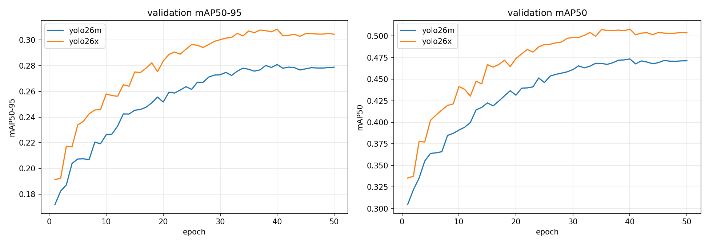
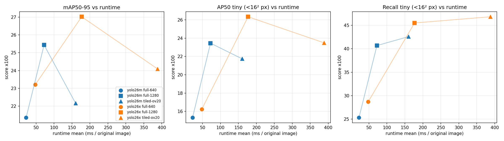
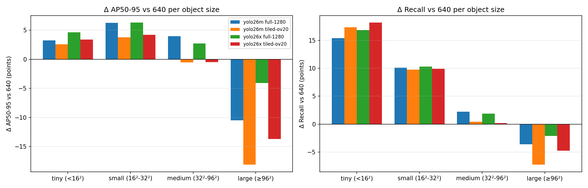
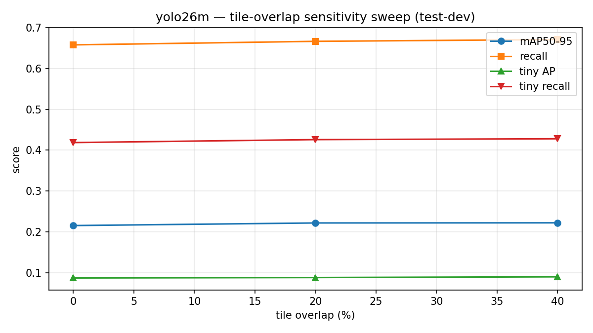
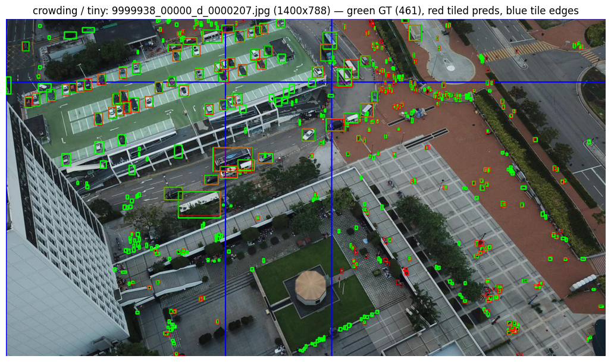
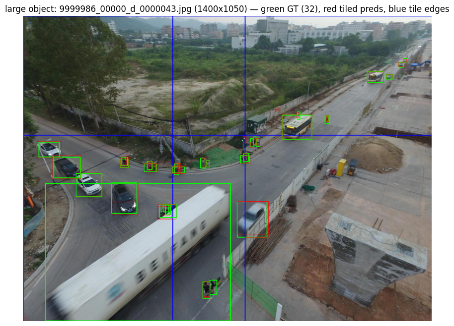
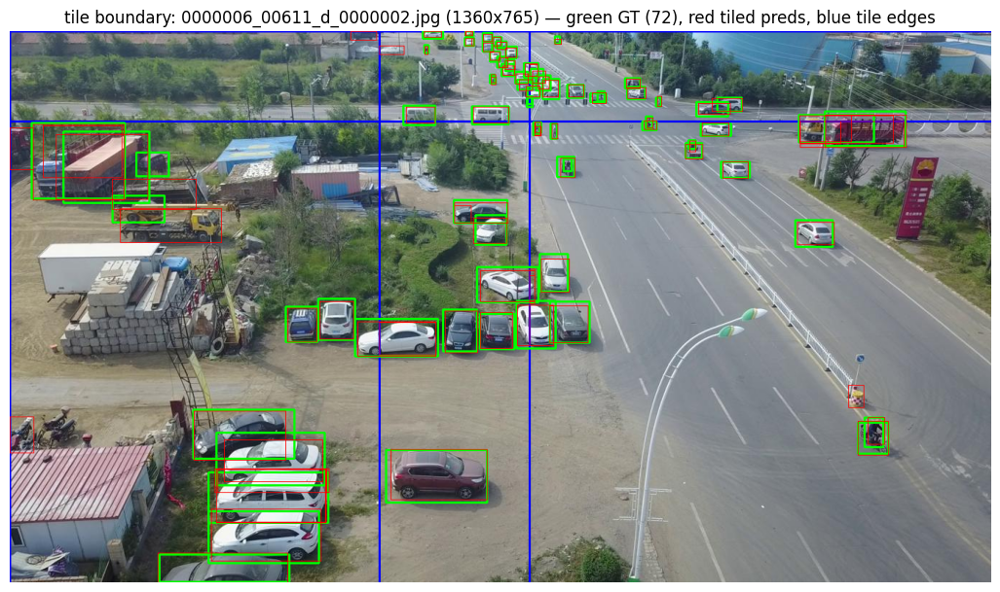

# Report: 640 vs 1280 vs tiling on VisDrone2019-DET

Report of project **P17 Small-Object Detection in Aerial Images**: *"Compare standard
resizing with tiling or higher-resolution inference. Report AP/recall, runtime, and failure
cases involving very small objects."*

All numbers are on VisDrone2019-DET **test-dev** (1,610 images, 75,101 objects), computed with
the weights from the full fine-tune (50 epochs) by one shared evaluator,
[`src/evaluation/metrics.py`](../src/evaluation/metrics.py). Raw numbers (0–1, every metric):
[`results/metrics_all.csv`](../results/metrics_all.csv); column guide:
[`results/README.md`](../results/README.md). The numbers follow our protocol and are not
official VisDrone leaderboard scores.

---

## 0. Summary

| Question | Answer |
|---|---|
| Does higher inference resolution help small objects? | **Yes, a lot.** Both 1280 and tiling raise recall on tiny objects (<16² px) by 1.6–1.7× (25 → 41–47 %) and AP on tiny objects by 1.4–1.7×. |
| Which is better, 1280 or tiling? | **1280.** Higher mAP (+4 points vs +0.9), higher AP on tiny and small objects, and **2.2× faster** than tiling. Tiling only wins recall on tiny objects (+1–2 points), and AP on tiny objects only on the largest frames (~1920 px), where it actually adds pixels over 1280. |
| What is the cost? | Runtime per image: 1280 ×3.3–3.7 vs 640, tiling ×7.2–8.1. Large objects (≥96² px) **regress** in both modes (1280: −4…−10 AP, tiling: −14…−18 AP). |
| What matters more for small objects: resolution or model capacity? | **Resolution.** yolo26x instead of yolo26m gives +1.6–1.9 mAP at ×2.2–2.5 runtime; 1280 instead of 640 gives +3.8–4.1 mAP. yolo26m@1280 (25.4) beats yolo26x@640 (23.2). |
| Which tile overlap? | 20 % is a sensible trade-off: 0→20 % gives +0.6 mAP, 20→40 % only +0.03 mAP at almost 2× p95 runtime. |

---

## 1. What is compared

Each model is fine-tuned **once**, at `imgsz=640`. The **same weights** are then evaluated under
three input modes. Only inference changes, so differences between modes are the effect of the
input resolution, not of training.

| Mode (task wording) | In the project | What happens to the image | Forward passes per image |
|---|---|---|---:|
| standard resizing | `full-640` | the whole image is downscaled to a 640 long side (1920×1080 → 640×360) | 1 |
| higher-resolution inference | `full-1280` | the whole image is resized to a 1280 long side | 1 |
| tiling | `tiled-ov20` | the image is cut at **native resolution** into 640×640 crops with 20 % overlap; boxes are mapped back to image coordinates and merged with NMS (IoU 0.7) | 2–8 |

Two models × three modes = **6 main experiments**, plus a tile-overlap sensitivity analysis
(0 / 20 / 40 %) for yolo26m.

**What "1280" means for different frames.** `imgsz` is not a fixed network input (YOLO is fully
convolutional and accepts any size divisible by 32); it is the length the long side is resized
to. Frames smaller than `imgsz` are **upscaled** (no new detail, only interpolation). Test-dev has
six native sizes:

| Native size | Images | Scale at 640 | Scale at 1280 | Tiles (20 %) |
|---|---:|---:|---:|---:|
| 960×540 | 49 | ×0.67 | **×1.33 (upscaling)** | 2 |
| 1360×765 | 167 | ×0.47 | ×0.94 | 6 |
| 1400×788 | 933 | ×0.46 | ×0.91 | 6 |
| 1400×1050 | 274 | ×0.46 | ×0.91 | 6 |
| 1916×1078 | 151 | ×0.33 | ×0.67 | 8 |
| 1920×1080 | 36 | ×0.33 | ×0.67 | 8 |

For **85 %** of the images (width 1360–1400), 1280 is almost native resolution (×0.91–0.94).
Tiling (×1.0) adds only ~10 % per side (~20 % in area) over 1280; only for the 187 frames of
width ~1920 does it add substantially more (×1.0 vs ×0.67, 2.2× in area). This explains most of
the results below.

---

## 2. Data

Official VisDrone2019-DET splits, nothing reshuffled. 10 classes (pedestrian, people, bicycle,
car, van, truck, tricycle, awning-tricycle, bus, motor); "ignored regions" and "don't care"
areas are excluded from training targets and respected by the evaluator (predictions inside
them are not penalised).

| Split | Images | Objects | Role |
|---|---:|---:|---|
| train | 6,471 | 343,197 | training the weights |
| val | 548 | 38,759 | **only** best-epoch selection and early stopping |
| test-dev | 1,610 | 75,101 | **only** the numbers in this report |

No hyperparameters were tuned on val — they were fixed by the protocol in advance; the only
value selected was the batch size (by GPU memory, not by accuracy; see §3).

**Test-dev objects by size** (area in original-image pixels, disjoint groups):

| Group | Area | Objects | Share |
|---|---|---:|---:|
| tiny | < 16² (256 px²) | 27,345 | 36.4 % |
| small | 16²–32² | 23,491 | 31.3 % |
| medium | 32²–96² | 21,856 | 29.1 % |
| large | ≥ 96² | 2,409 | 3.2 % |

Two thirds of all objects are small. Test-dev has more tiny objects than train (36.4 % vs
26.0 %, see the EDA), so absolute tiny-object numbers are lower than val would suggest; this
does not affect the comparison of modes, which are all scored on the same test-dev.

---

## 3. Training

Both models start from COCO-pretrained weights and are fine-tuned with **one shared config**
([`results/training_config.json`](../results/training_config.json)): `imgsz=640`, up to 50
epochs, `patience=15`, AdamW (`optimizer=auto`), `lr0=0.01` scaled to the batch (`nbs=64`),
cosine LR, `warmup_epochs=3`, `weight_decay=5e-4`, default Ultralytics augmentation,
`close_mosaic=10`, seed 42, all layers trainable. Batch 16 was chosen by a pilot on yolo26x
(1 epoch on 2 % of train): peak memory 15.1 GB on a 16 GB T4 (batch 4: 5.4 GB, 8: 9.5 GB).
Training ran on Kaggle, 2× Tesla T4, one model per GPU in parallel.

| Model | Parameters | Epochs | Best epoch | val mAP50–95 | val mAP50 | Wall time |
|---|---:|---:|---:|---:|---:|---:|
| yolo26m | 21.8 M | 50 | 40 | 0.281 | 0.473 | 3.2 h |
| yolo26x | 58.8 M | 50 | 40 | 0.308 | 0.508 | 7.9 h |

Both models plateau around epoch 40; early stopping did not trigger, so 50 epochs were enough.
For comparison, the short 5-epoch baseline run gave test-dev mAP50–95 at 640 of 18.5 (m) and
20.7 (x); the full run gives **21.4 and 23.2** (stage 1 was scored with the older evaluator,
see §4, so the comparison is approximate).

> The val metrics above come from the built-in Ultralytics validator (ignored regions not
> respected, different detection cap). They cannot be compared directly with the test-dev
> numbers below.

---

## 4. Evaluation protocol

All modes are scored by **one** evaluator; all parameters were fixed before looking at results:

| Metric | Definition |
|---|---|
| **mAP50–95** | COCO AP, IoU 0.50:0.05:0.95, confidence threshold 0.001 |
| **mAP50** | the same at IoU 0.5 |
| **Recall** | share of objects found at IoU ≥ 0.5 **and** confidence ≥ 0.25 |
| **AP / AP50 / Recall per size** | the same, restricted to objects of one group (tiny / small / medium / large) |
| **Runtime** | ms per **original** image, batch 1, 10 warm-up images, `cuda.synchronize`; tiling counts all tiles + merging; first 200 test-dev images; Tesla T4 |

Details that matter for a fair comparison:

1. **Same detection cap — 1000 per image — in every mode.** By default Ultralytics returns
   ≤300 boxes per *forward pass*: 300 per image at 640/1280, but 300 per *tile* with tiling (up
   to 2,400 per image). On crowded frames (up to ~900 objects) this favoured tiling. The cap is
   now equal (for tiling, after merging), and COCOeval also uses up to 1000 detections. The
   5-epoch stage-1 numbers in `docs/baseline_results.md` and `docs/tiling_results.md` were
   computed *before* this fix.
2. **Size groups are disjoint** (in COCO, "small" includes tiny). COCO-small is also kept in
   [`metrics_all.csv`](../results/metrics_all.csv) (`ap_small`) for comparability.
3. **AP50 next to AP50–95.** For a 10×10 px box, a 1–2 px shift already drops IoU below 0.75,
   so AP50–95 on tiny objects is depressed by the metric itself. AP50 answers "was the object
   found?", AP50–95 "how precisely was it localised?".
4. All coordinates are in original-image pixels; ignored regions are respected.
5. Single run, no confidence intervals: treat differences below ~0.5 points as noise. The
   conclusions below rest on differences of several points.

---

## 5. Results

All metrics below are ×100 (AP / recall points). Δ is the difference from `full-640` of the same
model, in points; × is a ratio.

### 5.1. Overall metrics and runtime (Table 1)

| Model | Mode | mAP50–95 | mAP50 | Recall | ms/img (mean) | ms/img (p95) | Δ mAP50–95 | Δ mAP50 | Δ Recall | × runtime |
|---|---|---:|---:|---:|---:|---:|---:|---:|---:|---:|
| yolo26m | 640 | 21.35 | 36.19 | 57.42 | 22.1 | 26.6 | — | — | — | — |
| yolo26m | **1280** | **25.43** | **43.26** | **66.72** | 72.2 | 75.6 | **+4.08** | **+7.07** | **+9.30** | 3.27 |
| yolo26m | tiling 20 % | 22.16 | 38.42 | 66.66 | 160.1 | 245.7 | +0.81 | +2.23 | +9.24 | 7.24 |
| yolo26x | 640 | 23.21 | 39.01 | 60.41 | 47.9 | 51.6 | — | — | — | — |
| yolo26x | **1280** | **27.02** | **45.52** | **70.24** | 176.9 | 187.2 | **+3.81** | **+6.51** | **+9.82** | 3.70 |
| yolo26x | tiling 20 % | 24.09 | 41.26 | 70.02 | 388.1 | 617.8 | +0.88 | +2.25 | +9.60 | 8.11 |

- **Recall** rises equally in both modes (+9–10 points): both find many more objects than 640.
- **mAP** rises mostly with 1280 (+4 points); with tiling by less than a point — the gain on
  small objects is eaten by the collapse on large ones (§5.2).
- **Runtime:** 1280 costs ×3.3–3.7, tiling ×7.2–8.1, and tiling's p95 is worse still (it
  depends on the number of tiles: 2 for a 960 px frame, 8 for 1920 px). On the plot, 1280 lies
  above and to the left of tiling for both models: **in accuracy per runtime, 1280 dominates
  tiling.**

### 5.2. Per object size (Table 2)

**yolo26m:**

| Size | Objects | Mode | AP50–95 | AP50 | Recall | Δ AP50–95 | Δ AP50 | Δ Recall |
|---|---:|---|---:|---:|---:|---:|---:|---:|
| tiny (<16²) | 27,345 | 640 | 6.21 | 15.31 | 25.29 | — | — | — |
| | | 1280 | **9.43** | **23.45** | 40.68 | **+3.22** | **+8.14** | +15.39 |
| | | tiling | 8.79 | 21.75 | **42.59** | +2.57 | +6.43 | **+17.30** |
| small (16²–32²) | 23,491 | 640 | 15.64 | 32.22 | 65.48 | — | — | — |
| | | 1280 | **21.87** | **41.96** | **75.60** | **+6.23** | **+9.74** | **+10.12** |
| | | tiling | 19.39 | 37.96 | 75.24 | +3.75 | +5.74 | +9.76 |
| medium (32²–96²) | 21,856 | 640 | 31.31 | 51.17 | 85.23 | — | — | — |
| | | 1280 | **35.25** | **55.54** | **87.46** | **+3.95** | **+4.37** | **+2.24** |
| | | tiling | 30.75 | 49.24 | 85.66 | −0.56 | −1.93 | +0.43 |
| large (≥96²) | 2,409 | 640 | **47.30** | **64.26** | **91.28** | — | — | — |
| | | 1280 | 36.82 | 52.52 | 87.67 | −10.48 | −11.74 | −3.61 |
| | | tiling | 29.19 | 42.55 | 84.02 | **−18.11** | **−21.71** | **−7.26** |

**yolo26x:**

| Size | Objects | Mode | AP50–95 | AP50 | Recall | Δ AP50–95 | Δ AP50 | Δ Recall |
|---|---:|---|---:|---:|---:|---:|---:|---:|
| tiny (<16²) | 27,345 | 640 | 6.47 | 16.23 | 28.69 | — | — | — |
| | | 1280 | **11.08** | **26.34** | 45.50 | **+4.61** | **+10.11** | +16.82 |
| | | tiling | 9.82 | 23.50 | **46.83** | +3.36 | +7.27 | **+18.14** |
| small (16²–32²) | 23,491 | 640 | 17.54 | 35.21 | 68.93 | — | — | — |
| | | 1280 | **23.80** | **44.93** | **79.25** | **+6.27** | **+9.72** | **+10.32** |
| | | tiling | 21.73 | 41.10 | 78.84 | +4.19 | +5.89 | +9.91 |
| medium (32²–96²) | 21,856 | 640 | 34.22 | 54.82 | 87.44 | — | — | — |
| | | 1280 | **36.94** | **57.40** | **89.30** | **+2.72** | **+2.58** | **+1.86** |
| | | tiling | 33.74 | 53.36 | 87.61 | −0.48 | −1.46 | +0.17 |
| large (≥96²) | 2,409 | 640 | **44.98** | **60.45** | **92.36** | — | — | — |
| | | 1280 | 40.90 | 55.86 | 90.24 | −4.08 | −4.58 | −2.12 |
| | | tiling | 31.26 | 45.44 | 87.59 | **−13.72** | **−15.00** | **−4.77** |

Observations:

1. **Small objects (tiny + small = 68 % of all objects) are where the gain is.** Recall on tiny:
   25 → 41–43 % (m) and 29 → 46–47 % (x). AP50 on tiny grows 1.4–1.6× — objects are actually
   *found*, not just outlined slightly better.
2. **AP50–95 on tiny objects stays low** (≤11) even in the best mode: found tiny objects are
   localised imprecisely (AP50 is 2.4–2.5× AP50–95). For a 10 px object, a 1–2 px error already
   means IoU < 0.75 — a property of the metric as much as of the detector.
3. **On tiny and small objects, 1280 beats tiling in AP** (by +0.6…+2.5 points), while tiling is
   only slightly ahead in tiny recall (+1.3…+1.9). The reason is §1: for 85 % of the frames,
   1280 ≈ native resolution, so tiling has barely more pixels but cuts the image context.
4. **Medium:** 1280 helps (+2.7…+4.0), tiling does not (≈0).
5. **Large: both modes hurt**, tiling about twice as much (see §6).

### 5.3. Resolution vs model capacity (Table 3)

yolo26x − yolo26m within each mode, points:

| | 640 | 1280 | tiling 20 % |
|---|---:|---:|---:|
| Δ mAP50–95 | +1.86 | +1.59 | +1.93 |
| Δ mAP50 | +2.82 | +2.26 | +2.83 |
| Δ Recall | +2.99 | +3.51 | +3.35 |
| Δ AP50–95 tiny | +0.26 | +1.65 | +1.04 |
| Δ AP50–95 small | +1.90 | +1.94 | +2.35 |
| Δ AP50–95 medium | +2.92 | +1.69 | +2.99 |
| Δ AP50–95 large | −2.32 | +4.08 | +2.08 |
| Δ Recall tiny | +3.40 | +4.82 | +4.24 |
| × runtime (x / m) | 2.16 | 2.45 | 2.42 |

- The larger model gives **+1.6…1.9 mAP for ×2.2–2.5 runtime**. Raising the input to 1280 gives
  **+3.8…4.1 mAP for ×3.3–3.7**.
- **On tiny objects, capacity at 640 is almost useless (+0.26 AP):** once an object is squeezed
  to 3–5 px, the bigger model cannot see it either. At 1280 the same gap is +1.65 — capacity
  helps once the object is given pixels.
- At comparable cost: **yolo26m@1280 = 25.4 mAP in 72 ms** vs **yolo26x@640 = 23.2 mAP in
  48 ms**. The best configuration overall is yolo26x@1280 (27.0 mAP, 177 ms).

**Answer to the project's secondary question:** for small objects, input resolution matters
more than model capacity.

### 5.4. Tile overlap — sensitivity analysis (Table 4)

yolo26m only, everything else fixed. This is **not** hyperparameter tuning: the main value of
20 % was fixed in the proposal in advance; the sweep only shows how much the result depends on
it (picking the best value on test-dev would be fitting to the test set).

| Overlap | mAP50–95 | Recall | AP tiny | AP small | AP medium | AP large | Recall tiny | ms (mean) | ms (p95) |
|---|---:|---:|---:|---:|---:|---:|---:|---:|---:|
| 0 % | 21.53 | 65.80 | 8.69 | 19.06 | 29.83 | 28.11 | 41.86 | 149.7 | 184.8 |
| **20 %** | 22.16 | 66.66 | 8.79 | 19.39 | 30.75 | 29.19 | 42.59 | 160.1 | 245.7 |
| 40 % | 22.20 | 67.10 | 8.97 | 19.50 | 30.64 | 29.43 | 42.79 | 200.6 | 469.7 |

- 0 → 20 %: +0.64 mAP, +0.86 recall, mostly on medium/large (objects on tile seams stop being
  lost), for +7 % mean runtime.
- 20 → 40 %: +0.04 mAP, +0.44 recall, while p95 runtime nearly doubles (245 → 470 ms): for
  wide frames the number of tiles grows from 8 to 15.
- Even 40 % overlap does not rescue large objects (AP large 29.4 vs 47.3 at 640): the problem is
  not the seams but the scale and the fact that the object is wider than a tile (§6).

### 5.5. Appendix: per native image size

The same metrics, separately for each group of frames
([`results/metrics_by_native_size.csv`](../results/metrics_by_native_size.csv)). The groups
come from different cameras, altitudes and scenes, so compare **modes within a group**, not
groups with each other. Δ is vs 640 within the same group; runtime is over the first 60 images
of each group.

**yolo26m:**

| Frame | Images | Scale 640 / 1280 | Tiles | Δ mAP 1280 / tiling | Δ AP tiny 1280 / tiling | Δ Recall tiny 1280 / tiling | ms 640 / 1280 / tiling |
|---|---:|---|---:|---|---|---|---|
| 960×540 | 49 | ×0.67 / ×1.33 | 2 | +2.4 / +1.9 | +3.8 / +4.0 | +10.6 / +8.9 | 20 / 65 / 55 |
| 1360×765 | 167 | ×0.47 / ×0.94 | 6 | +3.0 / −1.0 | +3.0 / +2.6 | +23.3 / +26.7 | 20 / 64 / 169 |
| 1400×788 | 933 | ×0.46 / ×0.91 | 6 | +4.6 / −0.0 | **+7.9 / +3.5** | +14.4 / +16.2 | 22 / 69 / 177 |
| 1400×1050 | 274 | ×0.46 / ×0.91 | 6 | +4.7 / +1.5 | +5.4 / +5.1 | +17.0 / +19.1 | 27 / 88 / 173 |
| 1916×1078 | 151 | ×0.33 / ×0.67 | 8 | +7.2 / +3.9 | **+6.6 / +8.8** | +16.1 / +22.6 | 26 / 71 / 235 |
| 1920×1080 | 36 | ×0.33 / ×0.67 | 8 | +4.0 / −0.3 | **+3.3 / +8.9** | +27.4 / +34.7 | 25 / 70 / 241 |

**yolo26x:**

| Frame | Images | Scale 640 / 1280 | Tiles | Δ mAP 1280 / tiling | Δ AP tiny 1280 / tiling | Δ Recall tiny 1280 / tiling | ms 640 / 1280 / tiling |
|---|---:|---|---:|---|---|---|---|
| 960×540 | 49 | ×0.67 / ×1.33 | 2 | +1.9 / +0.2 | +4.4 / +0.0 | +14.3 / +10.9 | 45 / 164 / 122 |
| 1360×765 | 167 | ×0.47 / ×0.94 | 6 | +3.7 / +0.8 | +4.6 / +3.9 | +24.0 / +27.5 | 46 / 162 / 442 |
| 1400×788 | 933 | ×0.46 / ×0.91 | 6 | +5.3 / +1.2 | +7.4 / +6.8 | +14.7 / +16.4 | 48 / 165 / 472 |
| 1400×1050 | 274 | ×0.46 / ×0.91 | 6 | +4.5 / +1.2 | +6.1 / +5.1 | +21.0 / +21.3 | 57 / 239 / 444 |
| 1916×1078 | 151 | ×0.33 / ×0.67 | 8 | +7.3 / +4.9 | **+6.4 / +7.5** | +19.3 / +22.6 | 51 / 170 / 599 |
| 1920×1080 | 36 | ×0.33 / ×0.67 | 8 | +6.0 / +1.4 | **+3.5 / +4.7** | +37.0 / +44.7 | 50 / 172 / 624 |

- **Where tiling really adds pixels (~1920 px frames: ×1.0 vs ×0.67 for 1280), it beats 1280 in
  AP on tiny objects** for both models (m: +8.8…+8.9 vs +3.3…+6.6). Where it does not (~1400 px,
  85 % of frames: ×1.0 vs ×0.91), 1280 wins. So the hypothesis "tiling is best for the smallest
  objects" **holds where tiling has a resolution advantage** — only 12 % of test-dev frames.
- **1280 helps even on 960×540**, where the frame is only upscaled (+1.9…+2.4 mAP): the gain
  comes not only from new information but also from objects becoming larger in the detector's
  "units" (closer to the sizes it handles well).
- Tiling runtime grows with the number of tiles (2 → 8); 1280 runtime is nearly constant.
- The 960×540 (49 images, 1 large object) and 1920×1080 (36 images) groups are small, so their
  numbers are noisy; Δ on large for 960×540 is meaningless.

---

## 6. Why: scale mismatch and tiles

**Train/test scale mismatch.** The model was trained on frames downscaled to 640 (objects
shrunk 1.5–3×) and learned the "usual" object sizes on its three output scales (stride
8/16/32). At 1280 inference, objects are ~2× larger than usual; with tiling, 1.5–3× larger:

- for **tiny/small** objects this helps: a 4 px object becomes an 8–12 px object the model has
  seen often;
- for **large** objects it hurts: a bus becomes larger than anything the model saw in training.

**Evidence from the data:** large objects also regress **at 1280, where there are no tiles at
all** (−10.5 AP for m, −4.1 for x). So part of the large-object drop is the scale itself, not
cutting. Tiling adds another −7.6 (m) and −9.6 (x) on top: an object wider than 640 px cannot fit
into one tile, gets cut into pieces, and NMS merges the pieces poorly. Scale augmentation
(±50 %) during training softens the mismatch but does not remove it. yolo26x's large-object drop
at 1280 is half that of yolo26m — the bigger model is more robust to scale.

**Why 1280 beats tiling on average:** for 85 % of test-dev frames, 1280 ≈ native resolution, so
tiling barely has more pixels, while 1280: (1) sees the whole frame — the model has context;
(2) cuts nothing at seams; (3) has no duplicates on overlaps to merge; (4) needs one forward
pass instead of 6–8.

---

## 7. Hypotheses check

| Hypothesis (proposal) | Verdict |
|---|---|
| Both tiling and 1280 raise small-object recall over 640 | ✅ **Confirmed.** Tiny recall +15…+18 points, small +10, for both modes and both models. |
| Tiling gains the most on the smallest objects | ⚠️ **Partially.** In tiny recall tiling leads (+1.3…+1.9 over 1280); in tiny AP it trails (−0.6…−1.3). Tiling beats 1280 in tiny AP only on ~1920 px frames (§5.5), where it actually adds pixels. |
| Each gain comes at a measurable runtime cost | ✅ **Confirmed.** 1280: ×3.3–3.7, tiling: ×7.2–8.1 (p95 up to ×12). |
| (secondary) Model capacity helps small objects as much as resolution | ❌ **No.** x instead of m: +1.6…1.9 mAP; 1280 instead of 640: +3.8…4.1. On tiny objects at 640, capacity gives almost nothing (+0.26 AP). |

---

## 8. Failure analysis

Three frames are selected deterministically, without cherry-picking (`tiling.ipynb`, section 5):
the most crowded frame, the frame with the largest object, and the first frame where a large
object crosses a tile boundary. Green = ground truth, red = tiling predictions with
confidence ≥ 0.25, blue = tile boundaries; model yolo26m.

### 8.1. Crowds of tiny objects

`9999938_00000_d_0000207.jpg` (1400×788, **461 objects**). Cars in the parking lot and on the
road are almost all found. The main misses are pedestrians on the square and on the sidewalk on
the right — figures a few pixels high, often standing in dense groups — many green boxes without
a red match. This is the dominant error type in every mode: even the best mode finds only
~41–47 % of tiny objects. This frame also shows why the shared detection cap was needed: on such
frames the old cap of 300 boxes per image (but not per tile) gave tiling an unfair advantage.

### 8.2. Large object cut by tiles (tiling regression)

`9999986_00000_d_0000043.jpg` (1400×1050). The truck in the lower left is wider than a tile and
crosses two tile boundaries — **tiling does not detect it at all** (no red box), although at 640
such an object is an easy case. A car next to a tile edge gets a shifted box. This is the
mechanism behind the large-object AP collapse (−18 for m): the object does not fit into one tile,
and pieces from different tiles do not combine into one box.

### 8.3. Objects on tile boundaries

`0000006_00611_d_0000002.jpg` (1360×765). Trucks at the upper-left edge and in the upper right,
crossing tile boundaries, get **several fragment boxes** instead of one; NMS does not merge them
when the fragments overlap little. This produces both false positives (a fragment is not an
object) and poor localisation. Cars fully inside a tile (frame centre) are outlined correctly.
20–40 % overlap mitigates this (§5.4) but does not eliminate it.

---

## 9. Limitations

1. **Training at 640 only** (by protocol) — hence the scale mismatch (§6). The comparison is fair
   for "what does changing the input do with the same weights", but does not answer "how to
   train best for each mode".
2. **Single run**, no confidence intervals or multiple seeds; differences < ~0.5 points are noise.
3. **Full train split instead of a "manageable subset"** from the task wording (the proposal
   justifies this: a subset would discard half the data; on Kaggle full training fit into
   ~8 h).
4. **Runtime measured on a Tesla T4**, batch 1, first 200 images; absolute numbers depend on the
   GPU, ratios between modes are more stable.
5. **val metrics in the training logs** come from the Ultralytics validator, not our evaluator.
6. **The 5-epoch stage-1 numbers** in `docs/baseline_results.md` / `docs/tiling_results.md` were
   computed before the detection cap was equalised — compare them with this report only
   approximately.
7. The 960×540 and 1920×1080 groups in the appendix are small (49 and 36 images).

---

## 10. Takeaways and next steps

- **Practical conclusion:** for small objects on VisDrone, the best trade-off is **full-image
  inference at 1280**; tiling pays off only for frames much larger than 1280 px and when recall on
  the very smallest objects is what matters.
- **Training matched to the inference mode:** training on 640×640 tiles at native resolution or
  multi-scale/1280 training would remove the scale mismatch and likely the large-object collapse.
- **Hybrid:** tiling + a full-image pass with merging (as in SAHI) — large objects from the full
  frame, small ones from the tiles.
- **Adaptive mode:** 1280 for frames ≤ 1400 px, tiling for ~1920 px frames (§5.5).

---

## 11. Reproduction

| Step | Command / file | Output |
|---|---|---|
| Data | `python scripts/prepare_data.py` | `data/` |
| Training (Kaggle, 2× T4) | `bash scripts/kaggle_finetune.sh` | `runs/finetune/<model>_s640/weights/best.pt` |
| Evaluation (Kaggle, T4) | `bash scripts/kaggle_eval.sh` | `runs/{highres,tiling,results}/finetune/` |
| Result tables | `notebooks/results.ipynb` | `runs/results/finetune/results_tables.md` |
| Raw numbers | [`results/metrics_all.csv`](../results/metrics_all.csv) | every metric, 0–1 |
| Archive | `python scripts/pack_results.py` | report + all computed results (+ checkpoints with `--with-weights`) |

Training took 3.2 h (m) and 7.9 h (x) in parallel on two T4s; the full evaluation took 2.7 h on
one T4 (~1.6 h for 640/1280 + appendix, ~1 h for tiling, the overlap sweep and failure cases).
